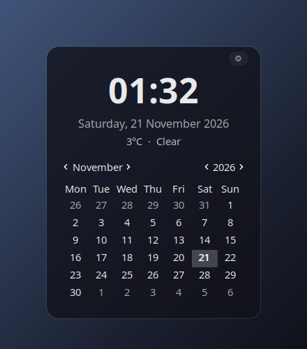
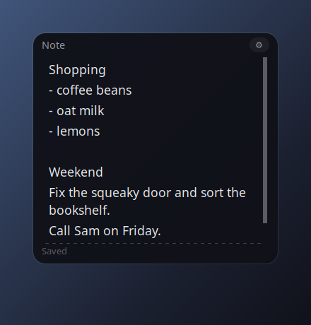

# Desktop Widgets

Two small, frameless desktop widgets for Linux, sharing the same clean look and
settings model:

- **Clock & Calendar** — live clock, date, month calendar and current weather.
- **Notepad** — an editable, autosaving plain-text note.

Drag them anywhere, resize them from any edge, fade them into the background,
and choose your own fonts, colours and opacity. Everything is remembered between
sessions. Built with Python 3 and GTK 3 (PyGObject), so there is nothing extra
to install on Linux Mint / Cinnamon.

| Clock & Calendar | Notepad |
|---|---|
|  |  |

## Clock & Calendar

- Live clock with custom `strftime` format (12/24-hour, seconds, etc.).
- Date line and month calendar with today marked.
- Current temperature and conditions, with automatic or manually chosen
  location and Celsius/Fahrenheit units.
- Optional week numbers and separate clock, date and calendar fonts.

### Weather

Weather appears under the date as, for example, `17°C · Partly cloudy`. It uses
the free [Open-Meteo](https://open-meteo.com/) API, which needs no account or
API key.

- On first run the widget estimates your town from your IP address (using
  ipwho.is, with ipapi.co as a fallback) and stores only the resulting
  coordinates locally.
- To choose a different place, open **Settings → Weather**, type a city name
  and click **Find**.
- **Use my location** repeats the IP-based lookup.
- Temperature refreshes every 30 minutes by default; change this in the Weather
  tab, or use **Refresh weather now** / right-click → Refresh weather.
- If there is no connection, the last reading stays visible and updates resume
  automatically. With no location at all, the weather line stays hidden.

Only the coordinates are sent to Open-Meteo with each request; the last reading
is cached in the settings file so it can be shown immediately at startup.

## Notepad

- Click in the text area to type; normal text editing, copy/paste and selection
  all work.
- Changes save automatically about half a second after you stop typing.
  `Ctrl+S` saves immediately.
- The note is a plain UTF-8 text file, so it can be backed up, synced or edited
  with any other program.
- **Clear note** in the settings or right-click menu asks for confirmation.
- Font, text colour, panel colour/alpha, window opacity and corner radius are
  all adjustable.

The note file lives at:

```
~/.local/share/desktop-notepad-widget/note.txt
```

## Run

```bash
git clone https://github.com/TheAliasAlias/desktop-clock-widget.git
cd desktop-clock-widget

python3 desktop_clock.py     # clock & calendar
python3 desktop_notepad.py   # notepad
```

On first launch the clock appears near the top-right of the screen and the
notepad near the bottom-right. Starting either one again while it is already
running simply brings it forward.

## Controls

| Action | How |
|---|---|
| Move | Drag the clock/date; drag the notepad's **Note** header or outer padding |
| Edit the note | Click in the notepad text area |
| Resize | Drag an edge or corner of either widget |
| Settings | Click the **⚙** button, or right-click the header/margins → Settings |
| Quick options | Right-click the header or outer padding |
| Text menu | Right-click inside the notepad's text area |
| Save note now | `Ctrl+S` |
| Settings shortcut | `Ctrl+,` |
| Quit | `Ctrl+Q`, or right-click → Quit |

If **Always on top** is disabled, a widget can sit behind other windows; use its
application-menu entry to bring it back. **Lock position and size** disables
dragging and resizing but leaves the settings button and menu working.

## Settings

The clock has **Clock**, **Date**, **Weather**, **Calendar**, **Appearance** and
**Behaviour** tabs. The notepad has **Text**, **Appearance** and **Behaviour**
tabs. Changes apply immediately while the settings window is open.

Both share these appearance controls:

- text colour
- background colour
- background alpha
- window opacity
- corner radius
- font (per text element on the clock, one font in the notepad)

### Background alpha vs. window opacity

- **Background alpha** changes only the panel behind the content: 0% is fully
  transparent, 100% is solid. This is the usual control for a translucent
  desktop widget.
- **Window opacity** fades the entire widget, including text.

### Clock format strings

Format strings use the standard Python `strftime` codes, for example:

| Code | Meaning |
|---|---|
| `%H` / `%I` | hour (24-hour / 12-hour) |
| `%M` / `%S` | minute / second |
| `%p` | AM or PM |
| `%A` / `%a` | weekday name / short weekday |
| `%d` / `%B` / `%Y` | day / month name / year |

So `%H:%M` gives `14:05`, and `%I:%M %p` gives `2:05 PM`.

## Install the menu and login entries

```bash
cd desktop-clock-widget
./install.sh
```

This adds application-menu entries for both widgets and start-at-login entries
for both. You can also toggle **Start automatically when I log in** in each
widget's Behaviour settings.

To remove all four entries:

```bash
./uninstall.sh
```

The autostart entries point at the scripts' current paths. If you move this
folder, re-run `install.sh` (or toggle the login option off and on again).

## Settings and data files

```
~/.config/desktop-clock-widget/config.json     clock settings
~/.config/desktop-notepad-widget/config.json   notepad settings
~/.local/share/desktop-notepad-widget/note.txt notepad text
```

Settings are written automatically whenever something changes. Delete a config
file (with the widget closed) to return that widget to defaults, or use
**Restore default settings** in its Behaviour tab. Resetting the notepad never
touches the note text.

## Requirements

- Python 3.8 or newer
- PyGObject (`python3-gi`) and GTK 3 (`gir1.2-gtk-3.0`)

Both are normally preinstalled on Linux Mint. To check:

```bash
python3 -c "import gi; gi.require_version('Gtk','3.0'); from gi.repository import Gtk; print('GTK ready')"
```

On Debian/Ubuntu/Mint, if needed:

```bash
sudo apt install python3-gi gir1.2-gtk-3.0
```

Transparency and rounded corners need a compositing window manager, which
Cinnamon, MATE, Xfce (with compositing) and GNOME all provide.

## License

MIT — see [LICENSE](LICENSE).
